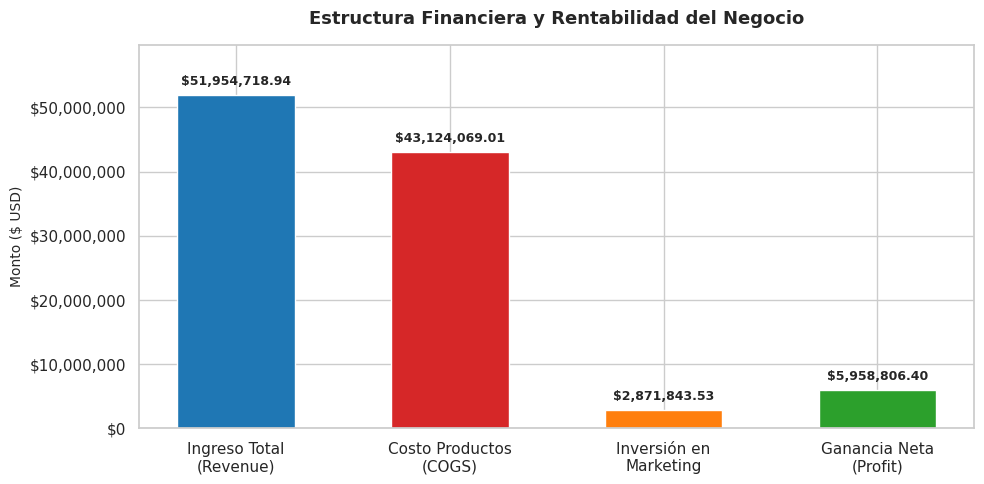
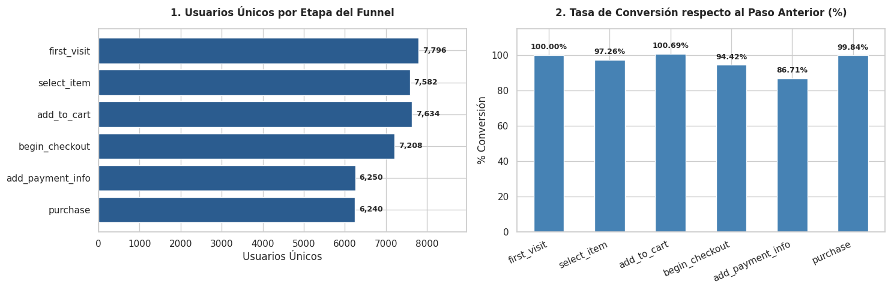
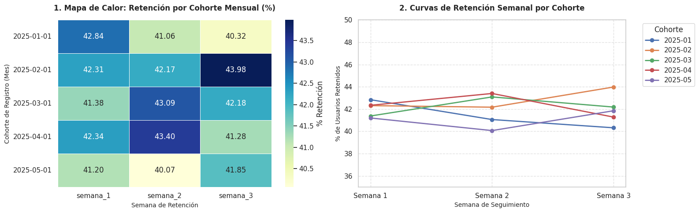

# 🛵 RappiPlus: de datos a decisiones de negocio

Análisis de datos de punta a punta de un servicio de suscripción de delivery: desde la limpieza de datos crudos hasta un dashboard ejecutivo, pasando por rentabilidad, embudo de conversión, retención por cohortes y un test A/B.

[](https://public.tableau.com/views/Proyecto_final_Gabriela_Lopez/Overview)


> **Nota:** caso de estudio del Bootcamp de Análisis de Datos de TripleTen (2026) con **datos simulados**. No tiene relación con Rappi ni usa información real de la empresa.

[](https://public.tableau.com/views/Proyecto_final_Gabriela_Lopez/Overview)

---

## 📌 Resumen en 30 segundos

- El negocio **es rentable**: $51.95M de ingresos y **margen neto de 11.47%** ($5.96M).
- La mayor fuga del embudo está en el **pago**: entre iniciar el checkout y registrar el método de pago se pierden **958 usuarios** (13.3%).
- La **retención semanal es estable (~42%)** en 5 cohortes: quien se activa, se queda.
- El rediseño del checkout **no tuvo un impacto significativo** (p = 0.42), así que no conviene atribuirle mejoras.

---

## 📌 Preguntas de negocio

| # | Pregunta | Enfoque |
|---|----------|---------|
| 1 | ¿Podemos confiar en los datos? | Calidad y limpieza de datos (Python) |
| 2 | ¿El negocio es rentable? | Revenue, costos, marketing y profit |
| 3 | ¿Dónde se pierden los usuarios? | Funnel de conversión (SQL) |
| 4 | ¿Los usuarios regresan? | Retención semanal por cohortes (SQL) |
| 5 | ¿El nuevo checkout mejora la conversión? | Test A/B: Z-test de proporciones |
| 6 | ¿Cómo comunicamos los resultados? | Dashboard en Tableau |

---

## 🗂️ Datos

| Fuente | Contenido |
|--------|-----------|
| `data/raw/rappiplus_orders_raw.csv` | ~25,100 pedidos: precios, descuentos, país, dispositivo y revenue |
| `data/raw/rappiplus_catalog.csv` | Costos unitarios, categorías y proveedores |
| `data/raw/rappiplus_marketing_spend.csv` | Inversión diaria en marketing por canal y país |
| `data/raw/experiment_checkout_ui.csv` | Resultados del experimento A/B en el checkout (10,000 usuarios) |
| `events` (SQL) | Eventos de navegación del usuario (funnel) |
| `users` / `user_activity` (SQL) | Registro y actividad semanal de usuarios |

---

## 🛠️ Herramientas

- **Python:** pandas, NumPy, Matplotlib, Seaborn, statsmodels
- **SQL:** PostgreSQL (CTEs, funciones de ventana `LAG` / `FIRST_VALUE`, `DATE_TRUNC`) vía SQLAlchemy
- **BI:** Tableau Public
- **Entorno:** Jupyter Notebook

---

## 🔍 Metodología

1. **Limpieza de datos:** conversión de fechas, eliminación de nulos y valores inválidos (cantidades o precios ≤ 0), validación de montos, eliminación de duplicados, normalización de categorías (`Electronica` → `Electrónica`) e imputación del canal de marketing a partir del ID de campaña.
2. **Rentabilidad:** unión de pedidos con catálogo para calcular el costo de lo vendido (COGS); cálculo de revenue, inversión en marketing, profit, margen, ticket promedio y producto más vendido.
3. **Funnel de conversión:** usuarios únicos por evento (`first_visit` → `select_item` → `add_to_cart` → `begin_checkout` → `add_payment_info` → `purchase`) y tasas de conversión paso a paso y acumuladas con funciones de ventana.
4. **Retención por cohortes:** cohortes por mes de registro y retención en las semanas 1, 2 y 3, con heatmap y curvas de retención.
5. **Test A/B:** H₀: la conversión de control y tratamiento es igual. Z-test de dos proporciones con α = 0.05.
6. **Dashboard:** vista ejecutiva de KPIs y vista de detalle con drill-through por producto, categoría y fecha.

---

## 📊 Resultados clave

### 💰 Rentabilidad



| KPI | Valor |
|-----|-------|
| Revenue total | **$51.95 M** |
| Costo de productos (COGS) | $43.12 M |
| Inversión en marketing | $2.87 M (5.5% del revenue) |
| **Ganancia neta** | **$5.96 M** |
| **Margen neto** | **11.47%** |
| Ticket promedio | $2,085.20 |
| Productos promedio por orden | 7.12 |
| Producto más vendido | Laptop-Gaming-16GB (144,198 unidades) |

La inversión en marketing se reparte de forma casi uniforme entre **social** (34.0%), **organic** (33.9%) y **paid search** (32.1%).

### 🛒 Funnel de conversión



- **80.04%** de los usuarios que llegan (7,796) terminan comprando (6,240).
- **Mayor fuga:** de `begin_checkout` a `add_payment_info` (86.71% de conversión): se pierden **958 usuarios** que ya tenían intención de compra.
- La conversión de `select_item` a `add_to_cart` supera el 100% porque hay usuarios que agregan productos al carrito sin pasar por la vista de detalle (desde la página principal o búsquedas).

### 🔁 Retención por cohortes (ene–may 2025)



- Retención muy estable: **~41–44%** en las semanas 1 a 3, en todas las cohortes.
- No hay una caída fuerte entre la semana 1 y la 3: los usuarios que superan la activación se mantienen.

### 🧪 Test A/B del checkout

| Grupo | Usuarios | Conversión |
|-------|----------|-----------|
| Control | 4,965 | 15.69% |
| Tratamiento | 5,035 | 16.29% |

Z = −0.81, **p-value = 0.416** → **no se rechaza H₀**. El nuevo diseño del checkout no muestra un impacto estadísticamente significativo en la conversión.

---

## 💡 Recomendaciones

1. **Optimizar la pantalla de pago:** reducir fricción en `add_payment_info`, ofrecer métodos de pago locales y billeteras digitales, y mostrar costos de envío y comisiones desde el inicio del checkout.
2. **Reasignar el presupuesto de marketing:** medir el ROI por canal y mover inversión hacia las fuentes con mayor conversión a compra.
3. **Activación temprana:** como la retención se estabiliza cerca del 42% desde la semana 1, concentrar onboarding y CRM en los primeros días después del registro.
4. **Iterar el experimento de checkout:** el cambio de UI probado no movió la conversión; conviene probar cambios enfocados en el paso de pago, que es donde está la fuga.

---

## 📈 Dashboard

👉 **[Ver dashboard interactivo en Tableau Public](https://public.tableau.com/views/Proyecto_final_Gabriela_Lopez/Overview)**

- **Overview ejecutivo:** revenue, profit, gasto en marketing, ticket promedio y evolución mensual.
- **Detalle / drill-through:** pedidos por producto con profit en formato condicional y filtros por fecha y categoría.

---

## 📁 Estructura del repositorio

```
├── notebooks/
│   └── rappiplus_analisis.ipynb   # Análisis completo
├── data/
│   └── raw/                       # CSV originales del caso
├── images/                        # Gráficas usadas en este README
├── requirements.txt
├── .env.example                   # Variables para la conexión a PostgreSQL
└── README.md
```

---

## ▶️ Cómo ejecutarlo

```bash
git clone https://github.com/gaby27lop-jpg/rappiplus-analisis-end-to-end.git
cd rappiplus-analisis-end-to-end
pip install -r requirements.txt
jupyter notebook notebooks/rappiplus_analisis.ipynb
```

- Las secciones de Python cargan los CSV desde URLs públicas del curso; también están en `data/raw/`.
- Las secciones de SQL (funnel y retención) se conectaron a una base PostgreSQL del bootcamp que no es pública. Para reproducirlas necesitas tu propia base con las tablas `events`, `users` y `user_activity`, y definir las variables de `.env.example`. Los resultados de esas consultas se pueden ver directamente en el notebook.

---

## 👩‍💻 Autora

**Gabriela López Larios**, Analista de Datos

[LinkedIn](https://www.linkedin.com/in/gabrielalopezlarios) · [GitHub](https://github.com/gaby27lop-jpg) · [Tableau Public](https://public.tableau.com/views/Proyecto_final_Gabriela_Lopez/Overview)
